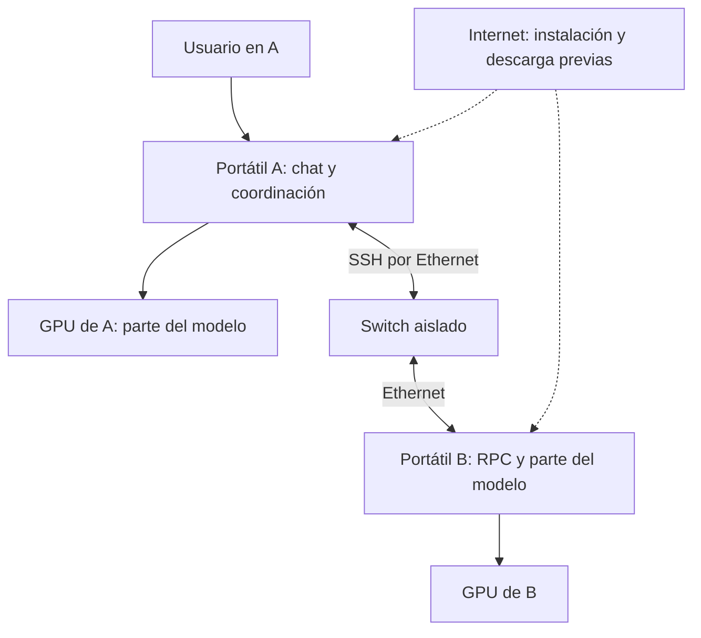

# Clúster de modelos locales con portátiles Ubuntu

Proyecto docente de **iesataulfoargentasor** para estudiar si los portátiles disponibles en el centro pueden colaborar ejecutando un mismo modelo de lenguaje local. El primer objetivo es construir un prototipo con **dos equipos**; después se decidirá, a partir de mediciones, si merece la pena ampliarlo a **cuatro**.

La necesidad inicial era trabajar con modelos de pesos abiertos sin depender de un servicio de inferencia en Internet, aprovechando equipos existentes. La dificultad era la memoria de cada GPU. La solución preparada usa **llama.cpp con CUDA y RPC**, con un coordinador A y una GPU remota en B, conectados por Ethernet.

## Estado del proyecto

**Preparación del prototipo, a 23 de octubre de 2026.** Se ha caracterizado un portátil, preparado scripts e instrucciones y superado 12 pruebas de lógica de red simulada. Todavía falta instalar y ejecutar el conjunto en los dos portátiles del centro. No hay medidas reales de tokens por segundo ni confirmación de que Qwen3-14B quepa con la configuración propuesta. Los tres informes recibidos proceden del mismo equipo.

## El objetivo en un dibujo



La prueba distribuye trabajo y memoria entre GPU. No convierte físicamente las dos tarjetas en una sola: hay comunicación por red y dependencias entre cálculos. Más equipos pueden aumentar la capacidad, pero la velocidad se debe medir.

## Por dónde empezar

**Manual para consultar sin Internet:** [descargar el PDF completo](https://github.com/iesataulfoargentasor/cluster-llm-portatiles/raw/refs/heads/main/output/pdf/manual-cluster-llm-portatiles.pdf) · [ver el PDF en GitHub](output/pdf/manual-cluster-llm-portatiles.pdf).

Incluye 34 páginas, índice enlazado, 12 capítulos y los seis esquemas incorporados. Guárdalo en ambos portátiles antes de aislar la red. Edición del 23 de octubre de 2026, basada en la revisión documental `f962ba4`. El PDF contiene las instrucciones; los scripts y el modelo se preparan por separado según la guía. Las referencias externas requieren Internet.

| Necesidad | Documento |
|---|---|
| Entender cómo surgió y evolucionó | [Historia del proyecto](docs/01_historia.md) |
| Conocer el equipo real y sus límites | [Hardware identificado](docs/02_hardware.md) |
| Entender A, B, CUDA, RPC y la red | [Arquitectura y decisiones](docs/03_arquitectura.md) |
| Ejecutar el prototipo Ubuntu 22.04 | [Guía completa](prueba_dos_portatiles/GUIA_PASO_A_PASO.md) |
| Consultar los comandos en orden | [Resumen para GitHub](docs/04_orden_de_ejecucion.md) |
| Llevar una hoja al laboratorio | [Hoja HTML imprimible](prueba_dos_portatiles/HOJA_RESUMEN.html), abrir localmente tras descargar |
| Registrar lo que realmente ocurre | [Validación y ficha de resultados](docs/05_validacion.md) |
| Preparar otros equipos o cuatro nodos | [Adaptación y ampliación](docs/06_ampliacion.md) |
| Entender las comprobaciones del paquete | [Registro de comprobaciones](prueba_dos_portatiles/COMPROBACIONES.txt) |

## Obtener los archivos en Ubuntu

**Para llevarlo en un pendrive:** [descargar el paquete ZIP completo](https://github.com/iesataulfoargentasor/cluster-llm-portatiles/raw/refs/heads/main/distribucion/prueba_dos_portatiles.zip). Incluye el PDF, los scripts, la hoja resumen, las guías y la herramienta de diagnóstico. Extrae su carpeta `prueba_dos_portatiles` en la Carpeta personal de cada equipo y abre `00_EMPEZAR_AQUI.txt`.

Este ZIP contiene documentación y scripts. Los pesos del modelo, CUDA y las dependencias se descargan durante la preparación con Internet, antes de conectar los equipos al switch aislado.

Con Internet, en cada portátil, descarga el repositorio mediante **Code → Download ZIP**. En Archivos de Ubuntu, abre Descargas, pulsa con el botón derecho sobre el ZIP y selecciona **Extraer aquí**. Abre la carpeta extraída y copia su carpeta `prueba_dos_portatiles` a tu Carpeta personal.

Como alternativa, si tienes Git instalado, abre una terminal y ejecuta:

```bash
cd "$HOME"
git clone https://github.com/iesataulfoargentasor/cluster-llm-portatiles.git
```

Copia la carpeta `prueba_dos_portatiles` del repositorio a tu Carpeta personal. La guía supone que queda en `~/prueba_dos_portatiles`. Si ya tienes una copia de una sesión anterior, consérvala con otro nombre antes de copiar esta. Mantén la misma versión del paquete en A y B.

Abre una terminal con **Ctrl+Alt+T** y comprueba que los archivos están donde corresponde:

```bash
cd "$HOME/prueba_dos_portatiles"
ls
```

Debes ver los scripts 01 a 08, `comun.sh`, `versiones.env`, `red_cluster.py` y `probar_modelo.py`. A continuación sigue el [orden de ejecución en A y B](docs/04_orden_de_ejecucion.md). Cada bloque indica en qué equipo y terminal ejecutarlo; al abrir una terminal nueva, vuelve a entrar en la carpeta del paquete.

Los documentos y scripts se descargan del repositorio; **los pesos del modelo y CUDA se descargan después**, durante los pasos de preparación. Guarda la guía HTML y la hoja resumen localmente antes de desconectar Internet. GitHub muestra el código de los HTML: para leerlos con formato, descárgalos y ábrelos en el navegador.

## Configuración concreta del prototipo

- Ubuntu **22.04.5 LTS**, Intel i7-12700H, RAM nominal 32 GB.
- NVIDIA **RTX 3060 Laptop, 6144 MiB de VRAM**, controlador observado 580.173.02.
- Ethernet **1 Gb/s**, interfaz observada `eno1`.
- CUDA Toolkit 12.8; compilación para capacidad CUDA 8.6.
- Qwen3-14B Q4_K_M; contexto 4096, una conversación, reparto por capas 1:1.
- IP de A: `192.168.50.10/24`; IP de B: `192.168.50.20/24`.
- Misma revisión de llama.cpp en ambos. Versiones, tamaño y SHA-256 en [versiones.env](prueba_dos_portatiles/versiones.env).

## Contenido y datos del laboratorio

El repositorio publica instrucciones, scripts y una síntesis técnica. Los informes brutos, direcciones MAC, identificadores de máquinas, consultas y registros reales permanecen fuera del repositorio. Tampoco contiene modelos, binarios de CUDA ni el artículo Word aportado como referencia durante la conversación. Antes de compartir un resultado, elimina datos personales o de la red del centro.

Los scripts de red se ejecutan localmente en Ubuntu y conservan los perfiles previos. RPC se mantiene en localhost y se transporta por SSH. La implementación oficial considera RPC experimental; el alcance es un laboratorio controlado. Véanse las [fuentes y versiones](docs/07_fuentes.md).

La documentación y los scripts se han preparado con asistencia de IA y revisión local. Los resultados de laboratorio deben completar esta primera edición. No se ha asignado una licencia general de redistribución a este repositorio; los componentes externos conservan sus propias licencias.
