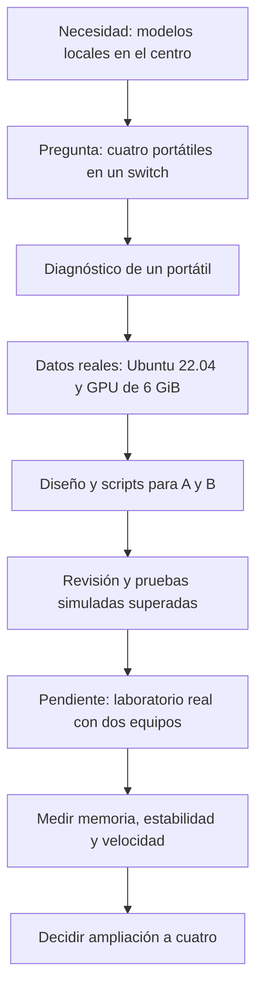

# Origen y evolución del proyecto

## La necesidad docente

El proyecto nace de la necesidad de ejecutar modelos de lenguaje en local utilizando los portátiles disponibles en el centro. La experiencia previa con herramientas como LM Studio y llama.cpp situaba el trabajo en una única máquina: el modelo debía ajustarse a su memoria o recurrir parcialmente a RAM y CPU.

La primera pregunta fue si cuatro portátiles conectados a un switch podrían colaborar para ejecutar un modelo mayor. La idea inicial hablaba de procesadores i7, GPU de 8 GB y Ubuntu 24.04. Esas características eran una estimación que había que comprobar antes de elegir software y modelo.

## De la pregunta al diagnóstico

Se solicitaron comandos para identificar GPU, RAM y Ethernet. Después se preparó un script de recopilación, porque el portátil personal desde el que se organizaba el trabajo no era uno de los equipos del centro. Así se pudieron recoger datos directamente en el equipo destinado a la prueba.

También se aportó un artículo en Word sobre ejecutar un modelo entre varias máquinas como material de referencia. Su existencia ayudó a situar la investigación; no se incorporan aquí su texto ni supuestos resultados como evidencia de funcionamiento de estos portátiles.

Se recibieron tres informes del mismo portátil. El diagnóstico corrigió dos supuestos importantes: el sistema era **Ubuntu 22.04.5 LTS** y la GPU tenía **6 GiB**, no 8 GB. La Ethernet negociaba a **1000 Mb/s Full Duplex**. Esos datos determinaron el diseño del primer prototipo.

## Por qué empezar con dos

Se decidió reducir el primer montaje a A y B para identificar por separado problemas de instalación, memoria, red y reparto del modelo. El objetivo de esta fase es comprobar que las dos GPU participan, que el modelo carga y que se pueden obtener mediciones repetibles. Añadir dos nodos más antes de conseguirlo multiplicaría las variables.

Se preparó una instalación con llama.cpp, CUDA y RPC, un modelo Qwen3-14B Q4_K_M y un túnel SSH. A mantiene el archivo del modelo y la interfaz de chat; B aporta su GPU. Se fijaron versiones para que ambos compilen el mismo código.

## El laboratorio sin Internet

La siguiente cuestión fue si la prueba podía funcionar en un switch aislado. Se separaron dos fases: instalación y descarga con Internet; inferencia posterior entre los equipos sin Internet. Como un switch aislado normalmente no asigna direcciones, se añadieron scripts para IP fija y retorno a DHCP.

Los scripts crean un perfil Ethernet de laboratorio y conservan los perfiles habituales. La vuelta a DHCP se diseñó para indicar claramente cuándo falta un servidor que entregue una dirección. Se incorporó una hoja resumen que distingue las terminales que deben quedar abiertas.

## Qué pruebas se han realizado

El trabajo efectuado en el portátil personal comprende comprobaciones de sintaxis y simulaciones de lógica. La revisión de red superó 12 casos simulados y llevó a corregir avisos de enlace, recuperación ante errores de entrada/salida y detección de perfiles alterados. Durante estas pruebas no se cambió la red del portátil personal.

La recopilación de hardware sí se ejecutó en un portátil del centro. **No equivale a haber ejecutado el modelo distribuido.** Esa prueba, el informe del segundo equipo y la medición del rendimiento siguen pendientes.

Esta es una reconstrucción del proceso a partir de las peticiones y los archivos conservados, no una transcripción literal de la conversación. Los informes de hardware utilizados están fechados el 23 de octubre de 2026.
