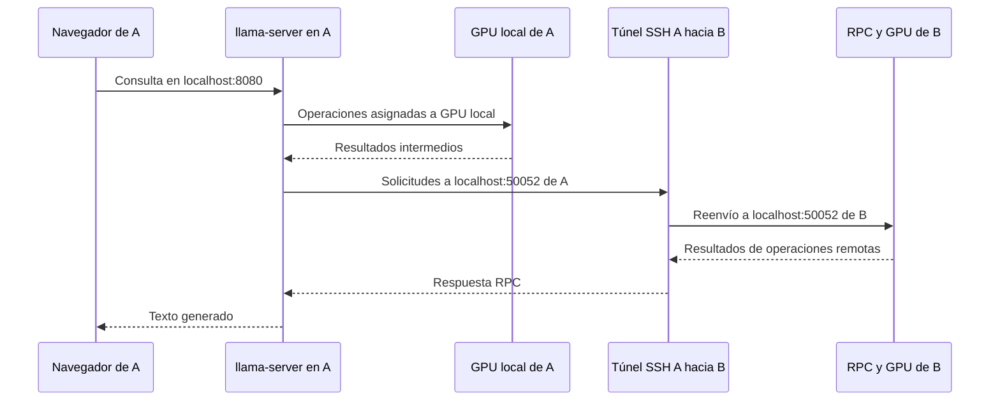
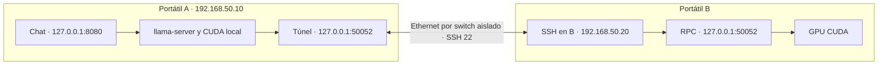

# Arquitectura y decisiones del prototipo

## Función de cada equipo

| Equipo | Archivos y procesos | Terminales durante la prueba |
|---|---|---|
| A | GGUF completo, llama-server, GPU local, túnel SSH y navegador | A1 túnel, A2 modelo, A3 consulta de medición |
| B | ggml-rpc-server, GPU remota y posible caché de tensores | B1 RPC |

CUDA permite utilizar la GPU NVIDIA. RPC permite que llama.cpp solicite operaciones a dispositivos remotos. El modelo utiliza reparto por capas: los cálculos tienen dependencias, por lo que no hay que esperar que ambas GPU estén al 100 % a la vez.

## Recorrido de una consulta

Esquema conceptual: el proceso repite operaciones durante la generación. La transferencia inicial de pesos se produce al cargar el modelo; no se vuelve a transferir todo el GGUF por cada token.

## Direcciones y puertos

`127.0.0.1` siempre corresponde al propio equipo. La página del chat se abre en A. RPC no se publica directamente en la red; el túnel llega a su puerto local en B. SSH añade trabajo y sus efectos forman parte de las mediciones de este montaje.

## Decisiones adoptadas

- **Dos equipos inicialmente:** permite aislar problemas antes de ampliar.
- **llama.cpp y GGUF:** formato y herramientas utilizados por el paquete. Este montaje no configura LM Studio.
- **Qwen3-14B Q4_K_M:** candidato de prueba cuantizado; su viabilidad se confirmará al cargarlo.
- **Versiones fijadas:** permiten repetir instalación y comparar A y B.
- **Contexto 4096 y una conversación:** limita el consumo inicial y facilita interpretar medidas.
- **Reparto por capas 1:1 y ajuste automático desactivado:** facilita observar la configuración solicitada. Si no cabe, se revisa explícitamente.
- **Instalación previa con Internet:** el funcionamiento aislado depende de disponer ya de herramientas, binarios, pesos y documentos.
- **Perfiles Ethernet separados:** permiten aplicar IP de laboratorio y recuperar DHCP sin sobrescribir el perfil habitual.

La documentación oficial describe RPC como experimental y permite uno o varios servidores remotos. Esa posibilidad técnica no acredita rendimiento en esta Ethernet. [Referencia de RPC en la revisión fijada](https://github.com/ggml-org/llama.cpp/blob/620d2225cc436ab0b001e3200e590e3b286ef9ab/tools/rpc/README.md).
