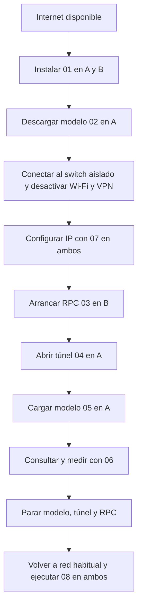

# Orden de ejecución en A y B

Sigue esta secuencia con el paquete completo en `~/prueba_dos_portatiles`. Utiliza una terminal local y el mismo usuario en cada equipo. No antepongas `sudo` a los scripts. Si un paso falla, consulta la [guía completa](../prueba_dos_portatiles/GUIA_PASO_A_PASO.md) antes de continuar.



## 1 Preparación con Internet

En ambos, comprueba primero la GPU y la interfaz Ethernet:

```bash
cd "$HOME/prueba_dos_portatiles"
nvidia-smi
nmcli device status
```

Conecta cargadores, evita suspensión y reserva espacio. Este montaje presupone el hardware descrito en la [ficha técnica](02_hardware.md).

En A:

```bash
bash ./01_instalar.sh A
bash ./02_descargar_modelo_A.sh
```

Ejecuta 02 solo después de que 01 termine correctamente. Espera a la comprobación de tamaño y hash del modelo.

En B:

```bash
bash ./01_instalar.sh B
whoami
ssh-keygen -lf /etc/ssh/ssh_host_ed25519_key.pub
```

Anota el usuario y la huella de B. Las instalaciones de A y B pueden realizarse al mismo tiempo. Termina ambas y la descarga antes de desconectar Internet.

## 2 Switch aislado

Conecta A y B al switch encendido y separado de la red del centro. Desactiva Wi-Fi y VPN desde Ubuntu para mantener el aislamiento.

En A:

```bash
bash ./07_configurar_red_aislada.sh A
```

En B:

```bash
bash ./07_configurar_red_aislada.sh B
```

Estos comandos usan `eno1`. Si la interfaz cambia, añádela: `bash ./07_configurar_red_aislada.sh B enp3s0`. Usa después esa misma interfaz al restaurar DHCP.

En A, cuando ambos tengan IP:

```bash
ping -c 3 192.168.50.20
```

A tiene `192.168.50.10/24` y B `192.168.50.20/24`, sin puerta de enlace ni DNS. Si ping no responde, revisa cable, IP y cortafuegos; el filtrado de ping no implica necesariamente que SSH falle.

## 3 Arrancar el conjunto

**B, terminal B1:**

```bash
cd "$HOME/prueba_dos_portatiles"
sudo systemctl start ssh
bash ./03_iniciar_rpc_B.sh
```

Espera a que aparezcan CUDA0 y el endpoint local. Deja B1 abierta.

**A, terminal A1:** sustituye `USUARIO_B` por el usuario anotado en B.

```bash
cd "$HOME/prueba_dos_portatiles"
bash ./04_abrir_tunel_A.sh USUARIO_B@192.168.50.20
```

Compara la huella SSH con la anotada y acepta si coincide. Introduce la contraseña de B cuando se solicite. Deja A1 abierta, aunque ya no muestre texto.

**A, nueva terminal A2:**

```bash
cd "$HOME/prueba_dos_portatiles"
bash ./05_iniciar_modelo_A.sh
```

Espera a que el servidor esté listo y deja A2 abierta. Abre en el navegador de A `http://127.0.0.1:8080` y realiza una consulta breve.

## 4 Observar y medir

En una terminal adicional de cada equipo:

```bash
watch -n 1 nvidia-smi
```

Comprueba VRAM ocupada en ambas GPU y los registros de carga. No es necesario ver actividad máxima simultánea. Ctrl+C cierra la observación.

En A, nueva terminal A3, con el modelo listo:

```bash
cd "$HOME/prueba_dos_portatiles"
bash ./06_probar_A.sh
```

No uses el chat mientras se mide. Repite el comando tres veces si quieres comparar consultas consecutivas. Completa la [ficha de resultados](05_validacion.md); el tiempo de carga se mide por separado.

## 5 Finalizar y recuperar DHCP

Pulsa Ctrl+C en este orden:

1. A2: servidor del modelo.
2. A1: túnel SSH.
3. B1: servidor RPC.

Conecta Ethernet a la red habitual con DHCP. En una terminal local de cada portátil:

```bash
cd "$HOME/prueba_dos_portatiles"
bash ./08_restaurar_dhcp.sh
```

Si usaste otra interfaz: `bash ./08_restaurar_dhcp.sh enp3s0`. Espera el mensaje de conexión DHCP activa. Si aún estás en el switch aislado, puede quedar pendiente: conecta a la red habitual y repite 08. Conserva `~/cluster_llm/red`. Restaura Wi-Fi, VPN y suspensión según sus ajustes habituales.

Si el perfil anterior tenía IP manual, 08 crea un perfil DHCP separado y conserva el original. En una red del centro con configuración especial, selecciona su perfil habitual desde Ubuntu.

## Si SSH está bloqueado por UFW

En otra terminal de B, consulta `sudo ufw status`. Solo si está activo y bloquea la conexión desde A:

```bash
sudo ufw allow from 192.168.50.10 to any port 22 proto tcp
```

Si añadiste esa regla únicamente para la prueba, retírala al terminar:

```bash
sudo ufw delete allow from 192.168.50.10 to any port 22 proto tcp
```

RPC permanece en localhost; no abras el puerto 50052 a la red. El servicio SSH puede seguir activo tras la prueba. Si se instaló solo para este proyecto y nadie más lo necesita, la guía explica cómo pararlo.

## Otra sesión

Conserva instalación y modelo. Empieza de nuevo por la conexión al switch y 07; después 03 en B, 04 y 05 en A y finalmente 06. La numeración de scripts se mantiene por compatibilidad con el paquete original.
