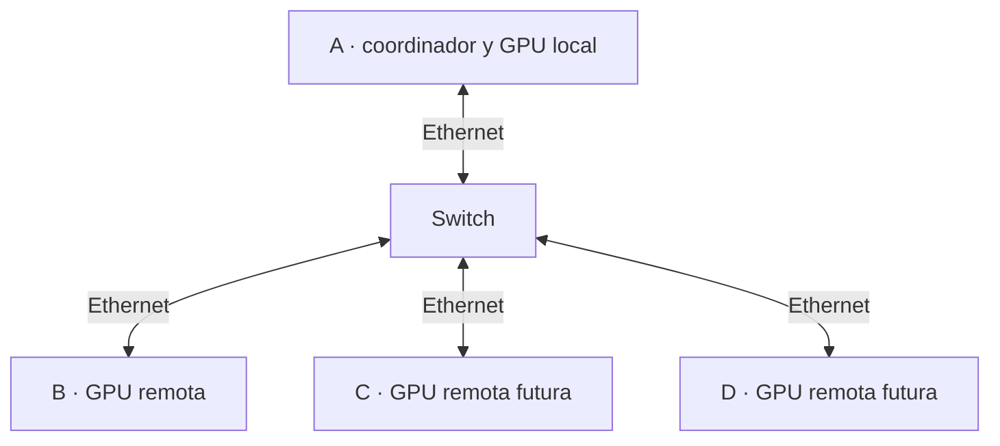

# Adaptación a otros equipos y ampliación a cuatro

## Lo que se puede reutilizar

El procedimiento de diagnóstico, la separación entre instalación y uso aislado, el registro de resultados y la organización coordinador/remotos sirven como base para otros laboratorios. Los scripts actuales tienen requisitos concretos: Ubuntu 22.04 x86_64, NVIDIA con capacidad CUDA 8.6, toolkit 12.8, un rol A y un rol B.

Antes de adaptar el paquete, recopila datos de cada nodo. Revisa sistema, controlador, arquitectura CUDA, VRAM libre, RAM, espacio, interfaz Ethernet y velocidad del enlace. No elimines las comprobaciones del instalador para forzarlo sobre hardware distinto: cambia y documenta los parámetros compatibles, y vuelve a comprobar la configuración.

| Cambio de entorno | Aspectos que hay que revisar |
|---|---|
| Otra GPU NVIDIA | Arquitectura de compilación, toolkit y controlador compatibles, memoria y reparto |
| Otra versión de Ubuntu | Repositorios, paquetes, compilador y funcionamiento de NetworkManager |
| Otra interfaz Ethernet | Argumento de interfaz en 07 y 08 |
| Menos VRAM | Tamaño del modelo, cuantización, contexto y buffers |
| GPU de otro fabricante | Backend y compilación; este instalador CUDA no la cubre |
| Más usuarios | Memoria y concurrencia; la configuración actual es de una conversación |

## Fase futura con cuatro equipos

Este esquema representa el objetivo posterior, **no una configuración ya implementada**. Los scripts actuales solo aceptan A y B y el servidor de A selecciona una GPU RPC. No basta con ejecutar los mismos scripts en cuatro equipos con el rol B: se repetirían direcciones y faltaría definir los otros endpoints.

## Pasos de la ampliación

1. Completar y conservar una sesión válida con dos nodos.
2. Recopilar informes independientes de C y D.
3. Reservar direcciones diferentes; propuesta: A `.10`, B `.20`, C `.30`, D `.40` en la misma subred `192.168.50.0/24`.
4. Ampliar los roles de instalación y los perfiles de red, incluido el retorno a DHCP de cada equipo.
5. Ejecutar un servidor RPC local en cada remoto y crear tres túneles desde A, con puertos locales diferentes, por ejemplo 50052, 50053 y 50054. Cada túnel puede llegar al 50052 local del remoto correspondiente.
6. Enumerar los dispositivos de la revisión fijada y adaptar `--rpc`, `--device` y `--tensor-split` a los dispositivos realmente detectados. No asumir nombres sin consultarlos.
7. Empezar con el mismo modelo y contexto para observar el efecto de añadir nodos. Después evaluar otro modelo si hay capacidad.
8. Comparar memoria, carga, latencia, velocidad y estabilidad con la sesión de dos equipos.

Cuatro RTX iguales sumarían 24 GiB nominales distribuidos. La conexión de A y las transferencias entre nodos pueden limitar el rendimiento. Un switch más rápido no mejora adaptadores de 1 Gb/s; cualquier cambio de red debe comprobarse de extremo a extremo. La decisión de ampliar dependerá de capacidad útil y experiencia real, no del número de GPU por sí solo.
